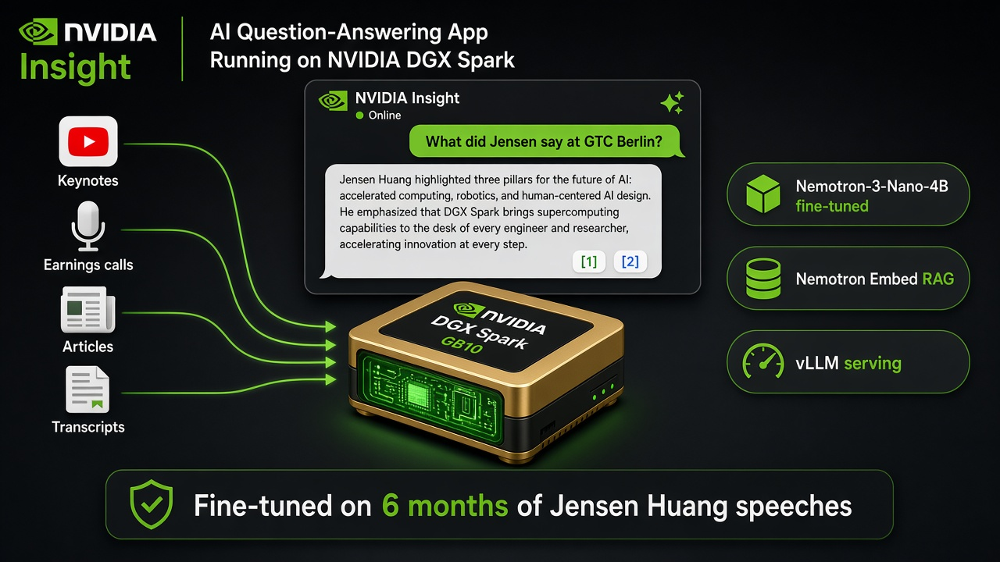
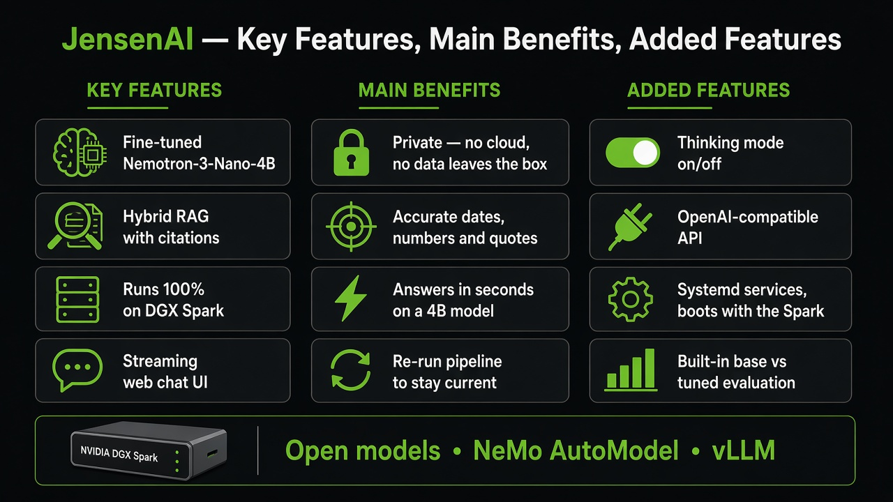
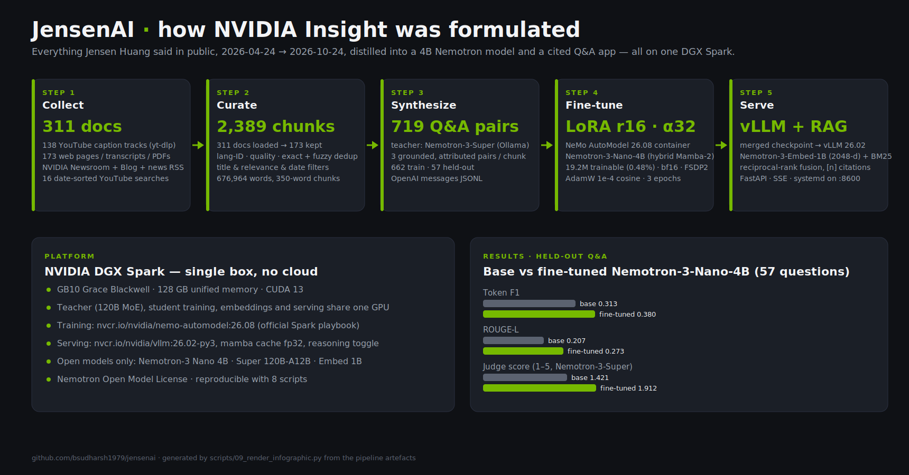
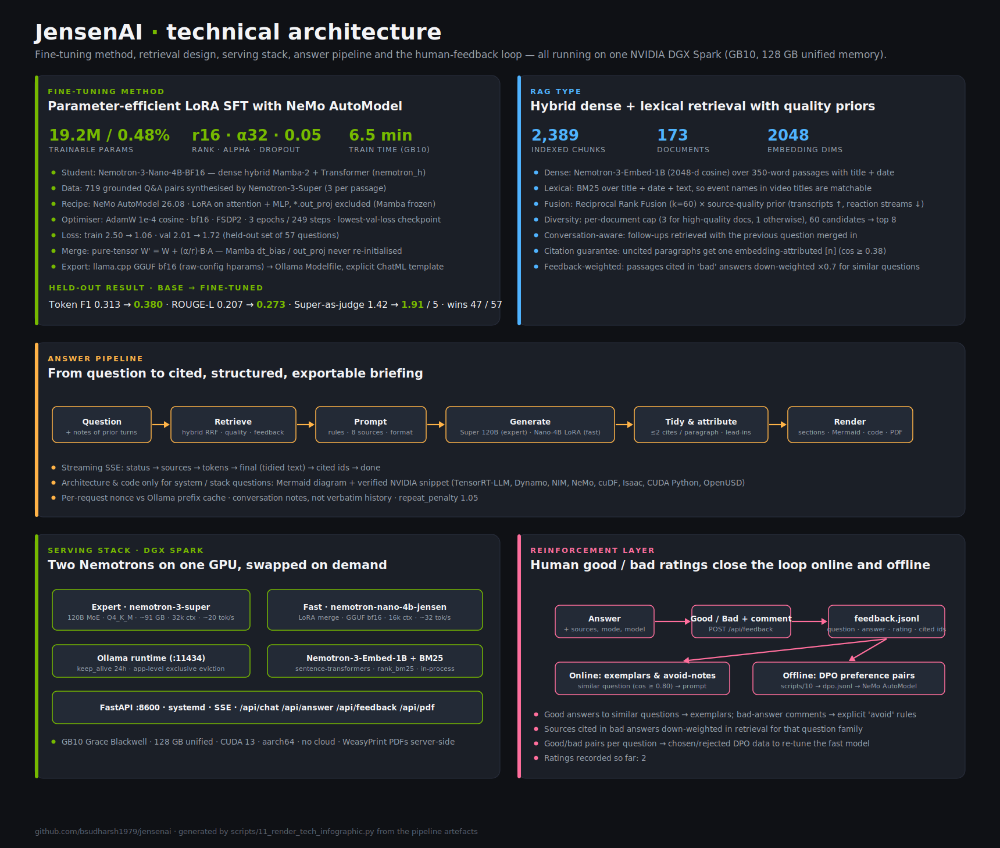

# JensenAI — Executive Summary

## What it is

**JensenAI / NVIDIA Insight** is a private, on-device question-answering assistant that knows what Jensen Huang,
NVIDIA's founder and CEO, has said publicly over the last six months (24 Apr – 24 Oct 2026) — keynotes at GTC
Taipei/Computex, SIGGRAPH and GTC Berlin, two earnings calls, analyst conferences, the annual stockholder meeting,
commencement speeches and dozens of interviews — plus NVIDIA's own newsroom and blog coverage from the same period.

Ask it *"What did Jensen announce at GTC Berlin?"*, *"How does he describe the five-layer cake?"* or *"What was
data-center revenue guidance on the Q2 FY27 call?"* and it returns a structured analyst briefing — Summary, Technical
view, Business view, Real-world use cases, Who is already using it, Insights — written in paragraphs, with numbered
citations that link back to the exact speech, article or transcript. Everything — teacher model, fine-tuning, embeddings, inference and the
web app — runs on **one NVIDIA DGX Spark** (GB10, 128 GB unified memory). No data leaves the box and no cloud API
is used.

## Key features, main benefits, added features

## Why it matters

* **Expert answers, verified.** In Expert mode Nemotron-3-Super reads the retrieved transcripts and reproduces the
  figures exactly — $96.2 B Q2 FY27 revenue, $108 B Q3 guide, $279 B supply commitments, the nine European companies
  Jensen named in Berlin — and says plainly when the sources do not name an adopter. Every sentence is cited.
* **Small model, domain knowledge.** The LoRA-fine-tuned 4B Nemotron (Fast mode) speaks fluently about Vera Rubin,
  DSX Pod, OpenShell and Hyperion — things the base model does not know (it answered a GTC Berlin 2026 question with
  H100-era facts) — and beats the base on every held-out metric.
* **Grounded, not just fluent.** Retrieval over the curated corpus keeps dates, dollar figures and attributions exact
  and verifiable; the fine-tune supplies vocabulary, framing and recall. The two together outperform either alone.
* **Edge-deployable blueprint.** The same recipe — collect → curate → synthesize → LoRA → serve — applies to any
  executive, product line or regulatory corpus, and runs on hardware that sits on a desk.
* **Fully open stack.** Nemotron-3 Nano (student), Nemotron-3 Super (teacher/judge), Nemotron-3 Embed (retrieval),
  NeMo AutoModel (training), vLLM (serving), all under permissive NVIDIA open-model licences.

## How it was formulated

| Stage | Method | Outcome |
|---|---|---|
| **1. Collect** | 16 date-sorted YouTube searches + known keynote IDs pulled through `yt-dlp` captions; transcripts, press releases, blog posts and news gathered through seed URLs, index crawls and RSS (NVIDIA Newsroom, NVIDIA Blog, Bing News) with `trafilatura`/`pypdf` extraction | 311 raw documents (138 YouTube, 173 web) |
| **2. Curate** (NeMo Curator stages) | Unicode & boilerplate cleaning → language ID → heuristic quality filters → title/person/event filters to drop retail stock-commentary videos → exact dedup → fuzzy dedup with hashed 5-gram shingles (catches re-streamed keynotes) → relevance & 6-month window → sentence-aware 350-word chunks | 173 documents, 2,389 chunks, 677K words |
| **3. Synthesize** | Nemotron-3-Super (120B-A12B MoE, local via Ollama, reasoning off) reads each chunk and writes three self-contained, correctly-attributed Q&A pairs; questions deduplicated, 8% held out | 719 Q&A pairs (662 train / 57 held-out) in OpenAI `messages` format |
| **4. Fine-tune** (NeMo best practices) | NeMo AutoModel LoRA recipe adapted from NVIDIA's `nemotron_nano_4b_squad_peft.yaml` and the DGX Spark `_rtx_spark` memory settings: r=16, α=32, dropout 0.05, all linear layers except Mamba `out_proj`; bf16, FSDP2, activation checkpointing; AdamW 1e-4 cosine; answer-only loss on the model's chat template; 3 epochs, lowest-validation checkpoint kept; adapter merged into a standalone checkpoint | 19.2M trainable parameters (0.48%), ~9 GB peak memory, 6.5 minutes on GB10; val loss 2.01 → 1.72 |
| **5. Serve** | Ollama hosts Nemotron-3-Super (Expert) and the fine-tuned Nano-4B GGUF (Fast); hybrid retrieval with Nemotron-3-Embed-1B (2048-d) + BM25 + a source-quality prior that favours verbatim transcripts; six-section briefings with guaranteed citations (uncited sentences are attributed by embedding similarity); FastAPI with streaming SSE and a web UI; systemd unit for boot-time start | Web app at `http://<dgx-spark>:8600`, API at `/api/answer` |
| **6. Evaluate** | Base vs fine-tuned on held-out questions: token-F1, ROUGE-L, and Nemotron-3-Super as LLM judge (1–5) | Fine-tuned beats base on all metrics: F1 0.380 vs 0.313 (+21%), ROUGE-L 0.273 vs 0.207 (+32%), judge 1.91 vs 1.42 (+35%); wins 47 of 57 questions |

## Technical architecture

* **Fine-tuning method** — LoRA SFT (r16/α32, 0.48 % of weights) on Nemotron-3-Nano-4B with NeMo AutoModel on the Spark itself, trained on 719 Q&A pairs distilled by Nemotron-3-Super; pure-tensor merge, GGUF export, served by Ollama. Held-out gains: +21 % F1, +32 % ROUGE-L, +35 % judge score.
* **RAG type** — hybrid dense (Nemotron-3-Embed-1B) + BM25 with reciprocal-rank fusion, a source-quality prior, per-document caps, follow-up-aware retrieval, a citation guarantee and feedback-based down-weighting.
* **Readable, exportable briefings** — six sections with bold sub-topic lead-ins and at most two citations per paragraph; technical questions add an architecture diagram (Mermaid) and a verified NVIDIA-library code example; every answer exports to an A4 PDF.
* **Reinforcement layer** — good/bad ratings with comments feed the next similar answer (exemplars, avoid-rules, retrieval weights) and accumulate into DPO preference data for re-tuning the fast model.

## Key design decisions

1. **Nemotron-3-Nano-4B over larger Nemotron variants.** Dense 4B hybrid Mamba-2/Transformer; NVIDIA lists DGX Spark
   as a target device; 262K context; leaves >100 GB of the Spark free for the 120B teacher and the embedding model to
   run concurrently. Nemotron-3.5 Lightning (30B-A3B MoE) and Bolt were considered but add MoE/quantisation
   complexity for little benefit at this corpus size.
2. **Synthetic Q&A instead of raw-text continued pre-training.** Nemotron's own post-training recipe distils domain
   data through a stronger Nemotron model; it also teaches attribution ("at GTC Berlin on 21 Oct 2026 Jensen said…")
   rather than parroting transcripts.
3. **LoRA, not full fine-tune.** 0.5% of parameters change, so general capability is preserved, training fits in
   minutes on the Spark, and the merged artefact is a drop-in for the base model in vLLM/TensorRT-LLM/Ollama.
4. **Fine-tune + RAG, not either/or.** The fine-tune carries the worldview and vocabulary; retrieval carries exact
   quotes and dates with citations users can check.
5. **Containers from the official DGX Spark playbooks.** `nemo-automodel:26.08` and `vllm:26.02-py3` are the
   NVIDIA-validated images for GB10; the pipeline is reproducible with nine numbered scripts.

## At a glance

* **Hardware:** 1 × NVIDIA DGX Spark (GB10, 20 Arm cores, 128 GB LPDDR5X, CUDA 13)
* **Corpus:** 311 → 173 documents, 2,389 chunks, 677K words, 1 May – 24 Oct 2026
* **Models:** Nemotron-3-Super-120B-A12B (expert generator, teacher & judge) · Nemotron-3-Nano-4B LoRA (fast generator) · Nemotron-3-Embed-1B (retrieval)
* **Training:** NeMo AutoModel LoRA, r16/α32, 3 epochs, bf16, FSDP2 — 719 synthetic Q&A pairs, 6.5 min on GB10
* **Result:** +21% F1 / +32% ROUGE-L / +35% judge score over the base model on held-out questions; RAG adds exact, cited figures
* **Serving:** Ollama (both generators) + FastAPI/SSE web app, systemd service; ~60 s per expert briefing, ~30 s fast
* **Repo:** <https://github.com/bsudharsh1979/jensenai>
